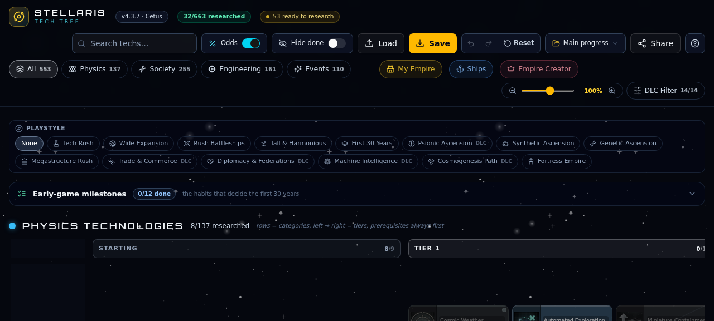

# Stellaris Tech Tree

An interactive research-progress tracker for [Stellaris](https://www.paradoxinteractive.com/games/stellaris) — all 663 technologies from version 4.3.7 “Cetus”, with real prerequisite/tier gating, DLC filtering, per-tech research odds, playstyle guides and offline support.

**Live site:** https://aiska93.github.io/stellaris-tech-tree/



## Features

- **Full 4.3.7 tech tree** — Physics, Society, Engineering and Special/Events projects, grouped by category and tier with real prerequisite edges; a card can only be checked once its prerequisites and tier gate are satisfied.
- **DLC-aware** — toggle any of the 14 DLCs to include or exclude their techs everywhere (tree, counts, odds).
- **Research odds** — turn on the odds badge to see each tech's chance of appearing in your next research hand, including your empire's weight modifiers.
- **Playstyle presets** — pick a path (Tech Rush, Wide Expansion, Rush Battleships, Psionic/Synthetic/Genetic Ascension, Megastructure Rush…) and every important tech gets an S/A/B rating, plus “next up” suggestions.
- **Path planner** — flag any tech as a goal; every missing prerequisite lights up and the banner tracks remaining techs and research cost.
- **My Empire** — apply your authority, ethics, civics and origin to lock/start techs exactly like the game does, and enter your monthly research output to get time-to-research estimates.
- **Ship designer** — generates the best possible design per hull from only the components you have researched.
- **Save / share** — named progress slots in the browser, JSON export/import, and copy-paste share codes (no server, no account).
- **Installable + offline** — works as a PWA; the whole tracker keeps running with no internet (handy for alt-tabbing mid-game).

## Getting started

```bash
bun install
bun run dev        # http://localhost:3000
```

Other scripts:

| Script | Purpose |
| --- | --- |
| `bun run dev` | development server |
| `bun run lint` | ESLint |
| `bun run start` | run the standalone production build (after `bun run build`) |

### Static export (GitHub Pages)

The deploy workflow (`.github/workflows/deploy.yml`) builds a fully static site:

```bash
NEXT_STATIC_EXPORT=1 NEXT_PUBLIC_BASE_PATH=/stellaris-tech-tree bunx next build
# → ./out
```

`NEXT_PUBLIC_BASE_PATH` must equal the repository name for project-page hosting. For root-domain hosting, omit it.

## Data source & credits

- Tech tree data (names, costs, weights, prerequisites, DLC tags, icons) is extracted from the community tech tree by **Turanar** and **BloodStainedCrow** ([stellaris-tech-tree](https://turanar.github.io/stellaris-tech-tree/), MIT license), covering Stellaris **4.3.7 “Cetus”**.
- The `scripts/` folder contains the data-prep pipeline (Python) that turns the raw dumps into `src/data/techtree.json`.
- App icon and wordmark styling are fan-made.

## License

Application code: [MIT](LICENSE). Tech tree data is MIT-licensed by its authors (see above).

Stellaris is a trademark of Paradox Interactive. This is a fan-made tool, not affiliated with or endorsed by Paradox Interactive.
